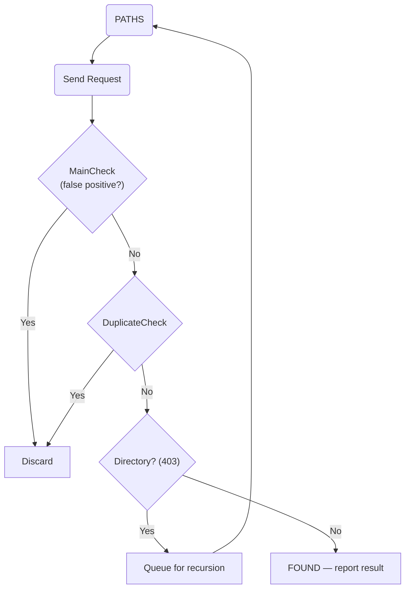

# hidden_fuzzer

> A fast, intelligent web content discovery tool that automatically filters false positives using similarity algorithms — no complex matchers or filters required.

[](https://golang.org)
[](LICENSE)
[](https://goreportcard.com/report/github.com/Serhatcck/hidden_fuzzer)
[](https://github.com/Serhatcck/hidden_fuzzer/releases)

---

## What is hidden_fuzzer?

**hidden_fuzzer** is a command-line tool written in Go for discovering hidden paths, directories, and resources on web applications. It is built for penetration testers, bug bounty hunters, and security researchers who need fast and accurate content discovery.

Unlike traditional fuzzing tools that require you to manually configure status code filters or response size matchers, hidden_fuzzer uses the **Jaro and Jaro-Winkler string similarity algorithms** to automatically detect and discard false positives — so you get clean results with a single command.

---

## Features

- **Automatic false positive detection** — Compares responses against a baseline using Jaro/Jaro-Winkler similarity. No need to set up `-mc`, `-fc`, or size filters manually.
- **Duplicate response filtering** — Tracks structurally identical responses and removes noise from results.
- **Recursive directory fuzzing** — Automatically queues discovered directories and fuzzes them up to a configurable depth.
- **Parameter fuzzing mode** — Append wordlist entries as query parameters instead of path segments.
- **Multi-threading** — Configurable number of concurrent goroutines for high-speed scanning.
- **Rate limiting** — Optionally throttle requests per second to avoid overwhelming targets.
- **Proxy support** — Route all traffic through an HTTP/HTTPS proxy (e.g. Burp Suite).
- **Custom HTTP headers** — Pass any header with `-H`, including authentication tokens.
- **X-Forwarded-For bypass** — Inject common IP spoofing headers with `-xff`.
- **Recheck mode** — Re-validate discovered URLs at the end of a scan.
- **Interactive mode** — Pause, inspect, and control a running scan without stopping it.
- **Pipe-friendly output** — Use `-pipe` to get clean URL-only output for chaining with other tools.
- **Extension expansion** — Automatically append file extensions (`.php`, `.html`, etc.) to each wordlist entry.

---

## Installation

### Install via Go (recommended)

```bash
go install github.com/Serhatcck/hidden_fuzzer@latest
```

### Use as a Go module

```bash
go get github.com/Serhatcck/hidden_fuzzer
```

Then import in your code:

```go
import "github.com/Serhatcck/hidden_fuzzer/pkg/hidden_fuzzer"
```

---

## Quick Start

```bash
# Basic directory discovery
hidden_fuzzer -u http://example.com -w wordlist.txt

# With file extensions and custom threads
hidden_fuzzer -u http://example.com -w wordlist.txt -e .php,.html,.js -t 100

# With authentication header and proxy
hidden_fuzzer -u http://example.com -w wordlist.txt -H "Authorization: Bearer <token>" -proxy http://127.0.0.1:8080

# Parameter fuzzing
hidden_fuzzer -u http://example.com/api -w params.txt -param-fuzzing

# Pipe output to another tool
hidden_fuzzer -u http://example.com -w wordlist.txt -pipe | httpx
```

---

## CLI Reference

| Flag | Default | Description |
|---|---|---|
| `-u` | — | Target URL **(required)** |
| `-w` | — | Path to wordlist file **(required)** |
| `-e` | — | File extensions to append, comma-separated (e.g. `.php,.html`) |
| `-H "Name: Value"` | — | Custom request header. Repeat for multiple headers |
| `-m` | `GET` | HTTP method (currently GET only) |
| `-t` | `50` | Number of concurrent threads |
| `-depth` | `3` | Maximum subdirectory depth to recurse into |
| `-fail-counter` | `3` | Consecutive failures before pausing |
| `-dp-counter` | `50` | Duplicate response threshold before suppressing |
| `-rd-counter` | `3` | Maximum redirect hops to follow |
| `-fc` | — | Filter out a specific HTTP status code from results |
| `-proxy` | — | Proxy URL (e.g. `http://127.0.0.1:8080`) |
| `-xff` | `false` | Inject X-Forwarded-For and related IP spoofing headers |
| `-xff-val` | `127.0.0.1` | IP value to use with `-xff` |
| `-param-fuzzing` | `false` | Fuzz query parameters instead of paths |
| `-param-value` | `test` | Value to assign to each fuzzed parameter |
| `-recheck` | `false` | Re-request all found URLs after the scan completes |
| `-max-compare-size` | `3000` | Maximum response body size (bytes) used in similarity comparison |
| `-rt-limit` | `0` | Requests per second limit (`0` = unlimited) |
| `-tm-out` | `20` | HTTP response timeout in seconds |
| `-fc-tm-out` | `1` | Failure check retry interval in seconds |
| `-silent` | `false` | Suppress all output except errors |
| `-only-stats` | `false` | Only show request statistics, not found URLs |
| `-no-interactive` | `false` | Disable interactive keyboard controls |
| `-pipe` | `false` | Print only discovered URLs to stdout (for piping) |

---

## How It Works

### False Positive Detection

When fuzzing begins, hidden_fuzzer first sends a request to the target URL to establish a **baseline response**. This baseline is used to filter responses that are structurally identical to a known-invalid page (e.g. a custom 404 page).

For each subsequent response, the tool compares the response body against the baseline using two metrics:

- **Jaro Distance** — measures character-level similarity
- **Jaro-Winkler Distance** — gives extra weight to matching prefixes

If both scores exceed the configured thresholds (`> 0.80` and `> 0.90` respectively), the response is considered a false positive and discarded.

### Duplicate Suppression

Responses that are structurally similar to each other (but not to the baseline) are grouped. Once a response pattern appears more than `dp-counter` times, it is suppressed from results.

### Recursive Directory Discovery



---

## Module Usage Example

```go
package main

import (
    "fmt"
    hidden_fuzzer "github.com/Serhatcck/hidden_fuzzer/pkg/hidden_fuzzer"
)

func main() {
    var conf hidden_fuzzer.Config
    err := conf.Build(hidden_fuzzer.Options{
        Url:              "http://example.com",
        Wordlist:         "wordlist.txt",
        Extensions:       ".php,.html",
        Method:           "GET",
        Threads:          50,
        FailureConter:    3,
        DuplicateCounter: 50,
        RedirectConter:   3,
        Silent:           false,
        TimeOut:          20,
        Depth:            3,
    })
    if err != nil {
        panic(err)
    }

    worker := hidden_fuzzer.NewWorker(&conf)
    if err := worker.Start(); err != nil {
        panic(err)
    }

    for _, found := range worker.FoundUrls {
        fmt.Printf("[%d] %s\n", found.Response.StatusCode, found.Request.URL)
    }
}
```

---

## Acknowledgments

- [ffuf](https://github.com/ffuf/ffuf) — inspiration for tool structure and fuzzing approach
- [hyperjumptech/beda](https://github.com/hyperjumptech/beda) — Jaro and Jaro-Winkler similarity algorithms used for false positive detection
